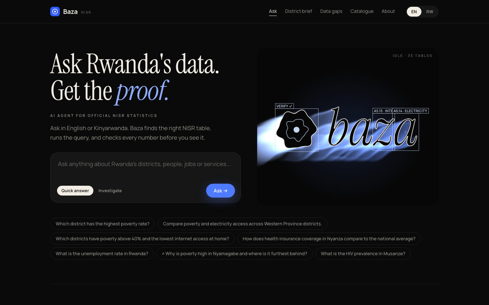
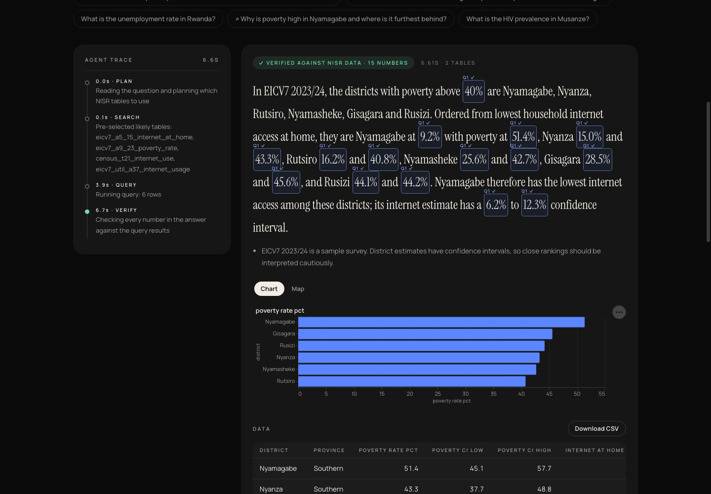
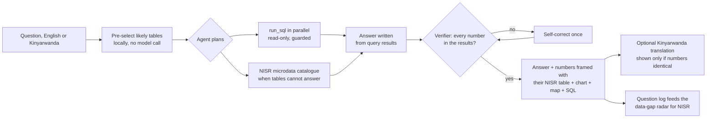
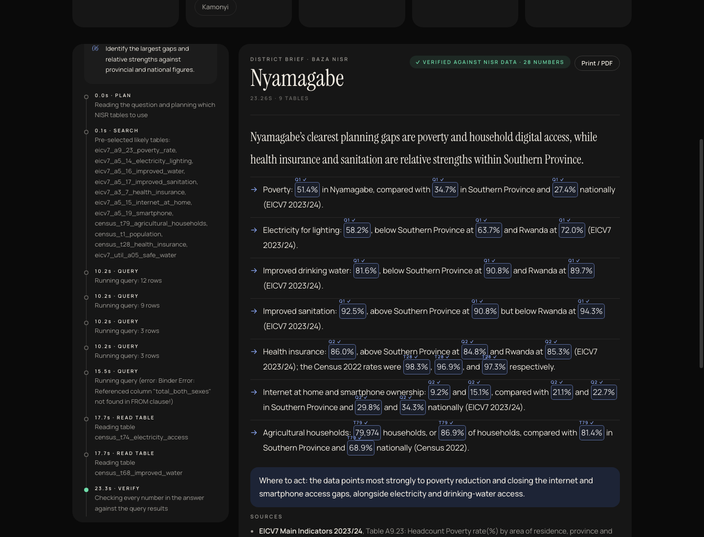
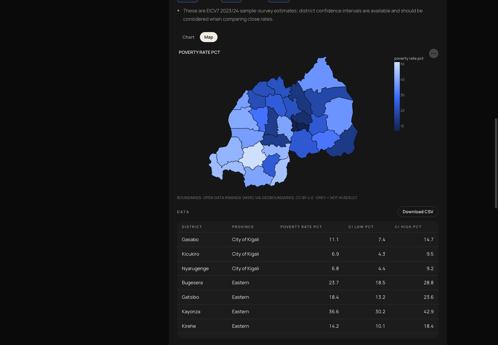
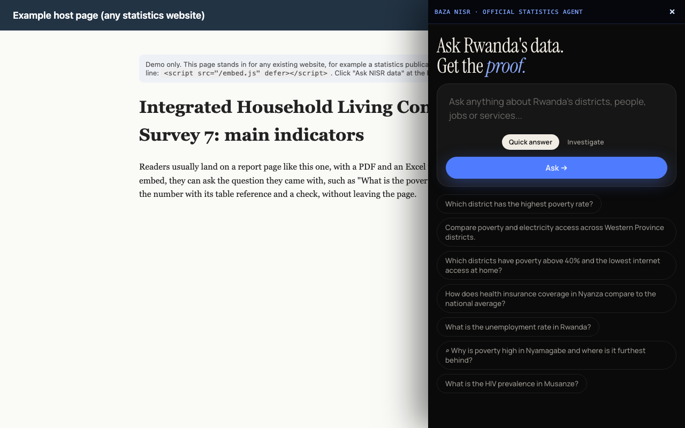
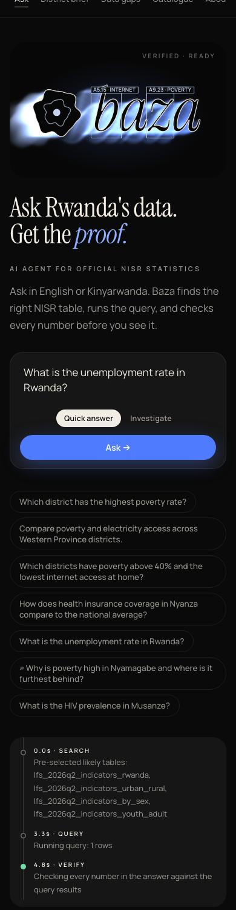

# Baza NISR

> **NISR already has the answer. It's on sheet 93 of 93.**
>
> Rwanda's poverty rate by district is published by NISR, on the last sheet of a 93-sheet Excel workbook. Electricity by district is in a different 101-sheet workbook. Both are in English, and NISR's data is spread across 7+ portals. Most planners never find it.

**Baza NISR is one AI agent over all of NISR's scattered data.** Ask in English or Kinyarwanda. It finds the right NISR tables, runs the query, and checks every number against the data before you see it, with the exact NISR table cited.

**Live demo:** https://baza-nsir.apps.thalesops.com/ · Try: *"Which districts have poverty above 40% and the lowest internet access at home?"*





Built for the NISR 2026 Big Data Hackathon, **Track 3: Open Innovation**. "Baza" means "ask" in Kinyarwanda.

---

## 1. The problem, in NISR's own words

A district planner in Nyamagabe wants to know how her district compares on poverty and electricity. NISR has published the answer, but poverty is on sheet 93 of 93 in the EICV7 workbook (Table A9.23), household electricity is on sheet 75 of 101 in the Census 2022 workbook (Table 74), and both are in English. She would have to know the surveys, find the sheets and join the numbers by hand. Usually nobody does, and the plan is written without them.

This is not our guess. NISR's own strategy, **NSDS4 (2024 to 2029)**, lists these weaknesses:

- *"Absence of a national integrated data repository"*: data sits in 7+ separate portals and hundreds of Excel and PDF tables. Our 5 source files alone have 339 sheets.
- *"insufficient use of local language"*: district workshops reported that only some publications are in Kinyarwanda.
- Reports must reach *"data users at both central and local levels, in real time"*, and NISR admits it has *"no strong methods to monitor the impact of data dissemination"*.

In post-census workshops (NISR, SDSN TReNDS and UK ONS), district officials said they *"had difficulty navigating the channels for accessing NISR data"*. NSDS4's answer is AI-assisted dissemination, APIs, Kinyarwanda publications and user feedback. **Baza NISR is a working version of that layer.** Sources: [NSDS4](https://statistics.gov.rw/documents/strategies-and-policies/fourth-national-strategy-development-statistics-nsds4), [TReNDS district case study](https://files.unsdsn.org/Rwanda+Case+Study+Report+v4.pdf), [NISR data portals](https://statistics.gov.rw/data-portals-e-gddssdds).

## 2. The solution: an agent, not a dashboard

NISR already has dashboards, and they show what someone decided to chart. Baza answers the question you actually have, shows its work, and proves its numbers.



**What the agent does**

| Capability | What it means for the user |
|---|---|
| **Live agent trace** | Each step streams to the page as it happens: plan, table search, queries, verification. |
| **Verified numbers, framed** | Every number in the answer is scanned and framed with the NISR table it came from (`A9.23 ✓`) or the query that produced it (`Q2 ✓`). Anything not in the data is flagged in amber. |
| **Investigate mode** | For "why" and "where" questions, the agent writes a plan, queries several surveys in parallel, compares the district with its province and Rwanda, and writes a short evidence brief. |
| **District brief** | Pick one of the 30 districts and get a printable one-page brief for Imihigo planning, community meetings or radio. In the example below, 28 numbers were checked across 9 tables. |
| **Knows what it does not hold** | When the loaded tables cannot answer, it searches **NISR's own microdata catalogue** (NISR's MCP server) and links to the right survey, for example the DHS 2019-20 for HIV. It never makes up a number. |
| **Kinyarwanda at any time** | Ask in Kinyarwanda, or switch any answer or brief to Kinyarwanda after it appears. The translation is shown only if it keeps exactly the same numbers. |
| **Data-gap radar** | Every question the tables could not answer becomes a signal for NISR: what people need, and which survey they were sent to. No names or IP addresses are stored. |
| **Ask NISR embed** | One script tag adds the agent to any web page as a side panel, so it can upgrade NISR's existing site instead of competing with it. |

| District brief (Investigate) | District map |
|---|---|
|  |  |

| Embed on any page | Phone |
|---|---|
|  |  |

**Fast by design.** Likely tables are pre-selected locally before the first model call, independent tool calls run concurrently, the catalogue and prompt are cached, and requests are served asynchronously. A typical question takes 3 to 8 seconds; a full district investigation takes about 25 seconds. Two questions sent together finish in the time of one.

## 3. Track and alignment with NST2 and Vision 2050

**Track 3: Open Innovation.**

- **Evidence-based planning.** NST2 (2024 to 2029) and Vision 2050 depend on decisions grounded in data. Baza NISR turns NISR's published tables into direct answers that a district official can read in one minute.
- **District Imihigo.** Rwanda plans and is held accountable at district level. The tool is district-first: all 30 districts are cleaned and matched across surveys, so "which districts..." questions work directly.
- **Data use and NISR's mission.** NISR wants more people to use official statistics. Every answer links back to the NISR file and report page, which sends users to the source.
- **Digital transformation.** A conversational interface over official statistics, in English and Kinyarwanda, lowers the skill needed to use data.
- **Trust.** The verifier and citations protect NISR's credibility: the tool cannot present a number that is not in NISR's data without a visible warning.
- **NSDS4 Pillars II and III.** Data uptake, statistical literacy "up to the lowest administrative entity", Kinyarwanda publications, and feedback mechanisms from users.

## 4. Data sources

All data is published by the **National Institute of Statistics of Rwanda (NISR)** under **Creative Commons Attribution 4.0 (CC BY 4.0)**, see https://statistics.gov.rw/data-sources. The raw files are kept unchanged in `data/raw/` with SHA-256 hashes in `data/raw/SOURCES.json`.

| Key | Survey and year | File | Tables loaded | Link |
|---|---|---|---|---|
| `census2022` | 5th Population and Housing Census (RPHC5), 2022 | PHC5-2022_Main_Indicators.xlsx | 15 district tables | [Excel](https://statistics.gov.rw/sites/default/files/documents/2025-02/PHC5-2022_Main_Indicators.xlsx), [report page](https://statistics.gov.rw/data-sources/censuses/Population-and-Housing-Census/fifth-population-and-housing-census-2022/main-indicators-5th-rwanda-population-and-housing-census-phc) |
| `eicv7_main` | EICV7 2023/24, Main Indicators Report | EICV7_Tables_MainIndicatorReport.xlsx | 8 district tables incl. poverty (A9.23) | [Excel](https://statistics.gov.rw/sites/default/files/documents/2025-04/EICV7_Tables_MainIndicatorReport.xlsx), [report page](https://statistics.gov.rw/statistical-publications/poverty-and-social-protection/eicv7-main-indicators-report-202324) |
| `eicv7_util` | EICV7 2023/24, Utilities and Amenities thematic report | Tables_EICV7_Utilities_Amenities_Thematic_Report.xlsx | 8 district tables | [Excel](https://statistics.gov.rw/sites/default/files/documents/2025-06/Tables_EICV7_Utilities_Amenities_Thematic_Report.xlsx), [report page](https://statistics.gov.rw/integrated-household-living-conditions-survey-7-eicv-7/eicv7-thematic-report-utilities-and-amenities-202324) |
| `lfs2026q2` | Labour Force Survey, quarterly series to Q2 2026 | RW_Quarterly_LFS_Tables_2026Q2.xlsx | 4 national tables | [Excel](https://statistics.gov.rw/sites/default/files/documents/2026-07/RW_Quarterly_LFS_Tables_2026Q2.xlsx), [report page](https://statistics.gov.rw/data-sources/surveys/Labour-Force-Survey/labour-force-survey-2026/labour-force-survey-2026-q2) |
| `eicv7_poverty` | EICV7 2023/24, Poverty Profile | EICV7_Tables_Rwanda_Poverty_Profile.xlsx | downloaded for reference, not loaded yet (no district rows) | [Excel](https://statistics.gov.rw/sites/default/files/documents/2025-05/EICV7_Tables_Rwanda_Poverty_Profile.xlsx) |

District boundaries for the map: Open Data Rwanda (NISR), 2012 districts, distributed by [geoBoundaries](https://www.geoboundaries.org) (RWA ADM2), CC BY 4.0, licence source www.statistics.gov.rw/terms-use. Simplified copy in `app/static/rwanda_districts.geojson`; all 30 names match the district reference list (tested).

The full list of the 35 tables, with columns and links, is on the app's Data catalogue page and in [data/clean/_catalog.csv](data/clean/_catalog.csv). Cleaned CSV copies are in `data/clean/`.

## 5. Methodology

In short:

1. **Download** (`pipeline/download.py`): fetch the 5 official workbooks, keep the original bytes, record URL and SHA-256.
2. **Generic sheet parser** (`pipeline/parse_excel.py`): finds the title, detects 1 to 3 header rows and flattens merged headers into names such as `total_both_sexes` or `urban_male`, finds the label column, converts numbers (`"13,246,394"`, `" 27.36 "`, `-`, `..`), removes "Back to List of Tables" and footnote markers, and keeps section headers (Sex, Quintile, District) in a `breakdown` column.
3. **Geography normalisation** (`pipeline/geo.py`): every row is classified as `national`, `province`, `district`, `urban_rural` or `other` using a reference list of the 30 districts and 5 provinces (`data/reference/districts.csv`). Names are trimmed, case-folded and stripped of "Province". One spelling slip in the source ("goma" for Ngoma in Census Table 59) is mapped and documented.
4. **Registry** (`pipeline/tables.py`): which sheets to load, with table id, unit and plain notes. Values are never typed here.
5. **Database** (`pipeline/build_db.py`): one DuckDB file with a `catalog`, one clean table per NISR table, an `indicators_long` table for cross-survey work and a `districts` table. A parse report checks that each district table has exactly 30 districts.
6. **Uncertainty is kept.** EICV7 annex tables keep `std_error`, `ci_low`, `ci_high`, `cv` and `design_effect`. The agent is told to mention confidence intervals, and it does (see the evaluation answers).
7. **Cross-survey joins** happen on the cleaned `district` key. Caveat: the Census is a full count from 2022, EICV7 is a sample survey from 2023/24. The agent names the survey and year for each number, and reports both when both sources cover the same indicator.

## 6. The agent and the verifier

**Agent** (`app/agent.py`): a tool-calling LLM loop with the tools `search_catalog` (keyword, synonym and fuzzy ranking), `describe_table`, `run_sql`, `search_nisr_catalog` (NISR's own MCP server at microdatabk.statistics.gov.rw), `make_chart`, `plan` (investigate mode) and `final_answer`. Before the first model call it pre-selects likely tables locally, so most questions need only two model calls. Read-only tool calls in the same turn run in parallel. Citations, the SQL list and the number frames are attached from the queries that actually ran, never from the model's text. Charts are built from query results. Steps stream to the browser as server-sent events (`/api/ask/stream`, `/api/brief/stream`).

**SQL guard** (`app/sql_guard.py`): one statement only, must start with SELECT or WITH, blocks write and admin keywords, file-reading functions (`read_csv`, `read_parquet`, `glob`...), reading files by path and `getenv`; adds `LIMIT 500`. The database is opened read-only with external access disabled and every query has a 5 second timeout. 34 test cases.

**Verifier** (`app/verifier.py`), why the app cannot quietly invent statistics:

1. Extract every number from the answer (`51.39`, `51.4%`, `13,246,394`, `13.2 million`).
2. Ignore table references (`Table A9.23`, `B.07`), survey names (`EICV7`), years and periods (`2022`, `2023/24`, `Q2`).
3. A number passes if it matches a value in the query results within rounding (51.4 matches 51.389; 13.2 million matches 13,246,394), or a simple difference or ratio of two result values ("4.6 times higher", "3.9 percentage points"), a row count or rank, or a number in a returned label (such as "16-30 years").
4. If any number fails, the model is asked once to correct its answer using only the query results. If it still fails, the answer is shown with an amber warning that lists the unmatched numbers.

The verifier has 19 unit tests, including an invented number, a wrong rounding and a false ratio, which all fail as they should.

## 7. Evaluation results

The 12 questions from the project brief are run by `make eval` (`scripts/run_eval.py`) against the real model. A question passes only if the expected districts and values appear, the right NISR table is cited, refusals say the data is not available, and the verifier passes. Expected values come from the raw NISR tables and are never given to the app.

<!-- EVAL:START -->

**Score: 12/12** on the local agent, 2026-10-30. Full answers: [docs/evaluation.json](docs/evaluation.json).

| # | Question | Result | Verifier | Latency (s) | Tables cited |
|---|---|---|---|---|---|
| 1 | Which district has the highest poverty rate? | PASS | verified | 7.9 | eicv7_a9_23_poverty_rate |
| 2 | What is the poverty rate in the City of Kigali? | PASS | verified | 4.6 | eicv7_a9_23_poverty_rate |
| 3 | Which 5 districts have the lowest poverty rates? | PASS | verified | 4.8 | eicv7_a9_23_poverty_rate |
| 4 | What was Rwanda's population in the 2022 census? | PASS | verified | 4.3 | census_t1_population |
| 5 | What is the population density of Kicukiro? | PASS | verified | 4.0 | census_t1_population |
| 6 | Compare poverty and electricity access across Western Province districts. | PASS | verified | 8.9 | eicv7_a9_23_poverty_rate, eicv7_a5_14_electricity_lighting, census_t74_electricity_access |
| 7 | Which districts have poverty above 40% and the lowest internet access at home? | PASS | verified | 6.5 | eicv7_a9_23_poverty_rate, eicv7_a5_15_internet_at_home |
| 8 | How does health insurance coverage in Nyanza compare to the national average? | PASS | verified | 7.7 | census_t28_health_insurance, eicv7_a3_7_health_insurance |
| 9 | What share of households in Rwanda use electricity for lighting? | PASS | verified | 5.6 | census_t75_lighting_source, eicv7_a5_14_electricity_lighting |
| 10 | What is the unemployment rate in Rwanda? | PASS | verified | 4.4 | lfs_2026q2_indicators_rwanda |
| 11 | What is the HIV prevalence in Musanze? | PASS | verified | 6.3 | none (refusal) |
| 12 | Who will win the next election? | PASS | verified | 2.9 | none (refusal) |

<!-- EVAL:END -->

## 8. How to run locally

Requirements: Python 3.11+, no Docker.

```bash
git clone https://github.com/abdulmujeeb29/baza_nsir.git baza-nisr
cd baza-nisr
python3 -m venv .venv
.venv/bin/python -m pip install -r requirements.txt
cp .env.example .env        # then put your LLM provider, model and key in .env
make data                   # optional: rebuilds data/baza.duckdb from data/raw/
make test                   # 160 tests
bash scripts/start.sh       # open http://localhost:8000
```

`.env` settings: `LLM_PROVIDER` (`azure`, `openai`, `gemini` or `anthropic`), `LLM_MODEL`, `LLM_API_KEY`, and `LLM_BASE_URL` for Azure OpenAI. Other commands: `make run` (dev server with reload), `make eval` (12-question evaluation), `make verify-all` (all gates).

## 9. How to deploy (no Docker)

The repo includes `data/baza.duckdb`, `Procfile` (`web: bash scripts/start.sh`) and `.python-version` (3.11), so any Python host (Render, Railway, a Nixpacks platform or a small VPS) can run it:

1. Build command: `pip install -r requirements.txt`
2. Start command: `bash scripts/start.sh` (it listens on `$PORT`)
3. Set `LLM_PROVIDER`, `LLM_MODEL`, `LLM_API_KEY` (and `LLM_BASE_URL` for Azure) in the host's dashboard, never in the repo.
4. Check `https://<your-url>/api/health` returns `"status":"ok"`.

`/api/ask` is rate limited to 20 questions per minute per client. Logs keep only the question text, latency, tools used and verifier status, never IP addresses or keys.

## 10. Judging criteria mapping

| Criterion | How Baza NISR earns it |
|---|---|
| Problem understanding and relevance | Serves evidence-based planning under NST2 and Vision 2050 and NISR's mission to increase data use. District-first, matching how Rwanda plans (district Imihigo). |
| Data use and methodology | 35 tables from 4 NISR publications (Census 2022, EICV7 main and utilities, LFS 2026), joined on a cleaned district key. Reproducible pipeline with tests on real values. Standard errors and confidence intervals kept. |
| Technical innovation | A planning, tool-using agent: text-to-SQL over a guarded read-only database, parallel tool calls, live streamed trace, a fallback to NISR's own MCP catalogue, and a verifier that frames every number with its source and forces one self-correction. |
| Usability and design | One question box, live trace, numbers framed with their source, charts and district maps, printable district briefs, CSV export, share links, phone layout, switch to Kinyarwanda at any time. |
| Tangible impact | Answers NSDS4's stated weaknesses directly (no integrated repository, little Kinyarwanda, weak local reach, no feedback loop). District briefs serve Imihigo; the data-gap radar tells NISR what to publish next; the embed lets NISR add it to its own site with one line. |

## 11. Limitations and future work

**Limitations**

- Only the 35 loaded tables can be answered. Health outcomes (HIV, nutrition), agriculture production and many other topics need more NISR sources.
- Census 2022 and EICV7 2023/24 differ in year and method; cross-survey comparisons are indicative.
- EICV7 district estimates have wide confidence intervals for some districts; small gaps between districts may not be meaningful.
- The LLM can still choose a less suitable table or phrase an answer poorly. The verifier checks numbers, not the reasoning. Simple differences, ratios and small counts are allowed, so a wrong but derivable number could in rare cases pass.
- Answers take about 3 to 8 seconds; questions that fall back to NISR's online catalogue can take up to about 20 seconds, investigations about 25 seconds, and Kinyarwanda adds one translation call. All depend on an external LLM service.
- The question log is a local file; a production deployment should move it to a database.
- Kinyarwanda answers are machine translated. Numbers are protected by the checks above, but wording should be reviewed by a native speaker before official use.

**Future work**

- Load more NISR tables: EICV7 Poverty Profile, all 61 Census district tables, Agricultural Household Survey, DHS indicators.
- Side-by-side district comparison and sector-level data when NISR publishes it.
- Voice in Kinyarwanda: ask by speaking and hear the answer read back, for people who cannot easily read or type, using Rwandan open speech models such as Digital Umuganda's. The same numeric checks would apply to spoken answers.
- Translate the whole interface (not only answers) into Kinyarwanda, and add SMS/USSD access for people without smartphones, as district workshops requested.
- Expose Baza's verified-number tools as an MCP server, next to NISR's catalogue MCP, so any AI assistant can answer Rwanda questions with checked numbers.
- Pull new releases automatically through NISR's DevInfo/SDMX API.

## 12. AI use disclosure

**The thinking is ours; AI coding agents helped us build it faster.**

What the team did:

- **Problem and research:** chose Track 3, studied NISR's portals and its NSDS4 strategy, and framed the problem as NISR's scattered sources rather than another dashboard.
- **System design:** decided on an agent over a single cleaned database of NISR tables, the district key that joins surveys, read-only SQL with a guard, the fallback to NISR's own catalogue, and the rule that every number must be verified against query results before anyone sees it.
- **Product decisions:** investigate mode, district briefs for Imihigo, Kinyarwanda with protected numbers, the data-gap radar as a feedback loop for NISR, the embed for NISR's own site, the speed targets, and the visual direction.
- **Review:** checked the outputs against NISR's published tables, set the evaluation questions and expected values, and reviewed the code and documentation.

How AI was used:

- **While building:** AI coding agents (including Anthropic's Claude Code) assisted in the code implementation and documentation from our design and instructions, and ran the tests we required as per our instructions. The agents worked under a written plan with an acceptance test for every task, and the team reviewed the results. We own the final code.
- **At runtime:** the app calls a large language model (Azure OpenAI by default; the provider and model are set through environment variables) to plan, write SQL and phrase the short answer. It never supplies the numbers: every number must come from a query on NISR data, and the verifier blocks or flags anything else.

## 13. Team

- **Abdulmujeeb Tiamiyu**: agent, backend, deployment. MS Engineering AI, Carnegie Mellon University Africa.
- **Carlos Ngoga**: data cleaning, validation, Rwandan context, documentation. Carnegie Mellon University Africa.

## 14. Licence and attribution

- **Data:** National Institute of Statistics of Rwanda (NISR), https://statistics.gov.rw, licensed CC BY 4.0. Cleaned tables in `data/clean/` and `data/baza.duckdb` are derived from NISR data and keep the same attribution.
- **Code:** MIT licence, see [LICENSE](LICENSE). Under the hackathon rules, intellectual property in the submission is assigned to NISR.
- Baza NISR is a student project and is not an official NISR product.
